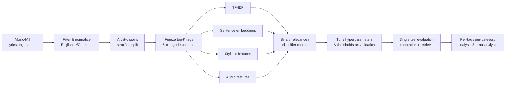

# DP1 – Lyrics-Based Music Auto-Tagging

**Design / Requirement Specification** (will evolve into the progress report and final ISMIR-format paper)

**Team:** Soorya Vasudevan, Mansoor Ali, Harish Pugazhenthi Sasikala  
**Repository:** https://github.com/sooryavasudevan007/Lyrics-based-auto-tagging

---

## 1. Project Description

Music auto-tagging assigns descriptive labels (genre, mood, theme, era, etc.) to songs. Most auto-tagging research works from audio. This project asks a different question: **how much of a song's tag profile can be predicted from its lyrics alone?**

We frame the task as **multi-label text classification**. Each song has a lyrics text and a set of user-generated tags from Music4All, and the system predicts the full tag set. We will:

1. Build a reproducible pipeline that loads, cleans, and aligns Music4All lyrics with tags.
2. Train and compare multi-label classifiers on sparse (TF-IDF) and dense (sentence-embedding) lyric representations.
3. Evaluate the system in both of Turnbull et al.'s settings [1]:
   - **Annotation:** predicting the tags for a given song.
   - **Retrieval:** ranking songs for a given tag.
4. Analyze which tag categories lyrics capture well (e.g., mood, themes) and which they capture poorly (e.g., instrumentation, production style). Compare against an audio baseline trained and evaluated on the same songs, splits, and tags. Audio results reported in the literature use different datasets, tag sets, and splits, so we discuss them qualitatively only and never compare their numbers directly with ours.

### Research Questions

- **RQ1:** How accurately can lyrics predict a song's tags, and how does this vary across tag categories?
- **RQ2:** Do dense semantic embeddings outperform TF-IDF features for lyrics-based tagging?
- **RQ3:** Does modelling correlations between labels (classifier chains) improve over independent per-tag classifiers?

### Hypotheses

- **H1 (RQ1):** Mood and theme tags will achieve higher macro-F1 and per-tag AUC than instrumentation/production tags, and lyrics will trail the MFCC audio baseline (Section 3.1) on genre tags.
- **H2 (RQ2):** Sentence embeddings will improve macro-F1 over TF-IDF, with the largest gains on rare tags.
- **H3 (RQ3):** Classifier chains will give a small but consistent gain over binary relevance, concentrated on strongly co-occurring tags (e.g., *sad* / *melancholy*).

All models must also clearly beat the trivial baselines in Section 3.2 for a result to count as meaningful.

### Motivation

Tags drive music search, recommendation, and playlist generation, but user-generated tags are sparse and biased toward popular tracks: new or niche songs often have few or no tags (the cold-start problem). Lyrics are widely available, cheap to process compared with audio, and carry semantic content (themes, emotions, narrative) that audio features capture only indirectly. Prior lyrics work has mostly addressed single-label tasks or small fixed taxonomies: genre [2–4], a few mood clusters [5–7], valence/arousal [8], or emotion categories [9]. A recent survey of lyrics information processing [10] organizes lyrics analysis around structure, mood, and topic estimation, and notes that mood estimation still depends on supervised, language-specific annotated lyrics. We found few studies that predict a large, open vocabulary of social tags from lyrics alone and evaluate both annotation and retrieval; this is the gap we target. Understanding which tags lyrics can and cannot predict also tells us where multimodal (lyrics + audio) systems are most likely to help.

---

## 2. Dataset

**Music4All** [11] contains about 109k songs. For each song it provides:
- a 30-second audio clip,
- metadata,
- lyrics,
- user-generated tags and genre labels,
- language information.

We use the **Music4All-EN** subset: 84,103 English-language songs with lyrics, tags, genres, Spotify metadata, and listening histories, but **no audio clips**. The audio baseline (Section 3.1) therefore needs the clips from the full release for the songs in our splits; this is tracked as a risk in Section 6.

**Dataset statistics** (frozen on Nov. 3; produced by `scripts/dataset_report.py`):

| Statistic | Value |
|---|---|
| Songs after language and length filters | 83,633 (470 removed for < 50 tokens) |
| Artists after filtering | 11,838 |
| Train / validation / test songs | 57,348 / 13,002 / 13,283 (68.6% / 15.5% / 15.9%) |
| Final vocabulary size *K* | 112 (top 100 by training frequency + 12 added for mood/emotion and theme) |
| Tags per category (genre / mood / theme / era / instr.-prod. / other) | 71 / 13 / 4 / 10 / 7 / 7 |
| Median tags per song (in vocabulary) | 3 |
| Median lyric length | 224 words |

Split checks: no artist appears in more than one split; the median per-tag prevalence difference between the training split and the validation/test splits is 0.002 (maximum 0.018); no tag fell below the 10-positive minimum in validation or test.

**Effect on H1.** As anticipated, genre tags dominate: the 100 most frequent training tags contain only 3 mood/emotion tags and 1 theme tag. Applying the mitigation below, we added the next most frequent mood/emotion and theme tags with at least 100 training songs (target: 15 per category), which raised mood/emotion to 13 tags but theme only to 4, because Music4All has no further theme tags that frequent. Theme is therefore too small for category-level conclusions on its own. For H1, mood/emotion and theme are analyzed together as one **mood + theme** group (17 tags), and per-tag results are still reported separately.

**Preprocessing** (implemented in `scripts/build_dataset.py`; details in `docs/data_pipeline.md`):
- Keep English-language songs with non-trivial lyrics, i.e., at least 50 tokens after cleaning.
- Normalize tags: lowercase them and merge spelling variants (e.g., `hip hop` / `hip-hop` / `hiphop`; 256 merges), plus a short, documented list of same-meaning words (e.g., `melancholic` → `melancholy`).
- Keep the top 100 most frequent tags, counted on the **training split only**, to avoid an extremely sparse long tail, then top up mood/emotion and theme as described above.
- Categorize tags into **genre, mood/emotion, theme, era, instrumentation/production, and other**, so that results can be analyzed by category. The mapping uses only the tag strings, never model results: a keyword lexicon suggests a category, and manual corrections are recorded with a reason in `splits/category_overrides.csv` (e.g., `death metal` → genre, `fip` → other, since it names a radio station).
- Use iterative stratification [12] for the train/validation/test split, so that tag distributions stay balanced across splits.
- Make the splits **artist-disjoint**: all songs by an artist go into the same split. Otherwise, a model can memorize an artist's recurring vocabulary and inflate test scores. Because iterative stratification works on rows, each artist is treated as one row whose label vector is the union of their songs' tags; artists are assigned to splits, and the assignment is then expanded back to songs. Because whole artists are assigned, the song proportions will only approximate 70/15/15; we report the actual song counts per split in the statistics table. A song-level random split is also reported to quantify the leakage effect (see the leakage check in Section 3.5).

**Leakage-free protocol.** Decisions are made in this order, and the test set is used only once, at the end:

1. Apply label-independent steps to all songs: language and length filters, and rule-based tag normalization (lowercasing, merging spelling variants).
2. Split songs into artist-disjoint train/validation/test sets (70/15/15), using iterative stratification on a broad candidate set (the 200 most frequent normalized tags). This uses only label frequencies to balance the splits; no model or tag-selection decision depends on it.
3. Select the final top-*K* tags by training-set frequency, topping up mood/emotion and theme from training-set frequencies only. Drop any tag with fewer than 10 positives in the validation or test set, a rule fixed in advance.
4. Assign tag categories and freeze the mapping, the vocabulary, and the splits (saved to version-controlled files) before any model is trained.

**Risks and mitigation:** Music4All tags are social (Last.fm-style) tags and are dominated by genre labels, so mood, theme, and instrumentation tags may be sparse after top-*K* filtering. If a category has too few tags, we will increase *K* for that category or merge it into a broader category, and we will report how many tags each category contains. (Both were needed; see *Effect on H1* above.)

---

## 3. Methodology

### Workflow

*Plain-text version (for viewers that do not render Mermaid):*

1. **Music4All** (lyrics, tags, audio) →
2. **Filter and normalize:** English, at least 50 tokens →
3. **Artist-disjoint stratified split** →
4. **Freeze** top-*K* tags and categories on the training split →
5. **Extract features** in parallel: TF-IDF, sentence embeddings, stylistic features, audio features →
6. **Train** binary relevance / classifier chains →
7. **Tune** hyperparameters and thresholds on validation →
8. **Evaluate once on test:** annotation + retrieval →
9. **Analyze** per tag and per category, with error analysis.

### 3.1 Features
| Representation | Description |
|---|---|
| Bag-of-words / TF-IDF [13] | Unigrams and bigrams, sublinear TF, min/max document-frequency pruning |
| Stylistic features | Rhyme, repetition, and text statistics, following Mayer et al. [3] (owned by Harish; see Section 8) |
| Sentence embeddings | Pretrained transformer encoders (Sentence-BERT [14]) applied to lyrics |
| Audio features (comparison only) | MFCC and spectral summary statistics from the Music4All 30-second clips; if time allows, a pretrained audio embedding (VGGish or OpenL3) as a stronger reference |

**Audio baseline limitation.** Hand-crafted summary statistics underrepresent what audio can achieve, so they may make lyrics look closer to audio than they really are. We treat the MFCC baseline as a lower bound on audio performance and say so wherever lyrics and audio are compared. A pretrained audio embedding, if added, gives a fairer upper reference.

### 3.2 Models
- **Trivial baselines:** predict the *n* most frequent training tags for every song (popularity baseline), and random scores drawn at each tag's training frequency. The popularity baseline gives every song the same score for a tag, so it cannot rank songs; it anchors annotation metrics only. The random baseline anchors retrieval metrics (its expected AP for a tag equals that tag's test prevalence).
- **Binary relevance:** `OneVsRestClassifier` with Logistic Regression, Linear SVM, or Naive Bayes. This is the baseline.
- **Classifier chains** [15], which model dependencies between labels.
- **Alternatives** if time permits: a small MLP or a fine-tuned transformer on embeddings.

### 3.3 Evaluation

Every model outputs a score matrix *S* (test songs × tags). Retrieval metrics use *S* directly; annotation metrics use it after thresholding (Section 3.4).

**Annotation** (predicting tags for each song):
- Micro- and macro-averaged precision, recall, and F1 over the *K* tags. Macro-F1 is the primary metric because it weights rare tags equally.
- Hamming loss: the fraction of song–tag pairs predicted wrongly. This is a secondary metric only: with sparse labels, predicting no tags already gives a low Hamming loss, so it barely separates models.

**Retrieval** (ranking songs for each tag, following Turnbull et al. [1]). For each tag *t*, rank all test songs by their score for *t* (ties broken by song ID). Let *R*ₜ be the number of test songs that have tag *t*, and rel(*i*) = 1 if the song at rank *i* has the tag.
- **Average precision:** AP(*t*) = (1/*R*ₜ) · Σᵢ P(*i*) · rel(*i*), where P(*i*) is the precision of the top *i* songs. This is non-interpolated AP, as computed by scikit-learn's `average_precision_score`.
- **MAP:** the mean of AP(*t*) over all *K* tags (macro over tags), also reported per tag category.
- **Precision@k:** the fraction of the top *k* ranked songs that have tag *t*, averaged over tags. We report *k* = 10, a common fixed cutoff, and R-precision (*k* = *R*ₜ) so that rare and frequent tags are comparable.
- **ROC-AUC:** computed per tag and averaged over tags.

Because Step 3 of the protocol guarantees at least 10 positives per tag in the test set, every tag has a defined AP and AUC.

**Statistical reliability:** 95% confidence intervals and paired comparisons use 1,000 bootstrap resamples of test songs (resampled by artist, to respect the artist-disjoint design). Aggregate comparisons (one test per research question) are core and reported uncorrected. *Stretch:* per-tag comparisons involve 50–100 simultaneous tests, so if we run them, their p-values are corrected with the Benjamini–Hochberg procedure (false discovery rate 0.05).

**Analysis:**
- Per-tag and per-category performance.
- Tag co-occurrence patterns and errors.
- The most informative terms for each tag.

### 3.4 Validation, threshold tuning, and final testing

1. **Training and model selection.** All models are trained on the training split. Hyperparameters (regularization strength, TF-IDF settings, embedding model, chain order) are chosen by validation macro-F1, with validation MAP as a tie-breaker.
2. **Threshold tuning.** Models without probabilistic outputs (Linear SVM) and poorly calibrated ones (Naive Bayes) are first calibrated on the training split with `CalibratedClassifierCV` (sigmoid, 5-fold), so every model outputs scores in [0, 1]. For each tag, the decision threshold is then chosen from a grid over [0, 1] to maximize that tag's F1 on the validation set. Tags with fewer than 20 validation positives use a single global threshold, tuned for validation macro-F1, to avoid overfitting. We also report a fixed 0.5 threshold to show the effect of tuning.
3. **Final testing.** Selected models are **not** retrained on train + validation, so their score scale stays consistent with the tuned thresholds. All choices are frozen and committed before the test set is scored, once. Trivial baselines are evaluated on the same test set.

**Limitation.** The same validation split drives hyperparameter search, threshold tuning, and model selection, so validation scores will be mildly optimistic. Only test-set scores are reported as results; validation scores appear only to document tuning.

### 3.5 Research questions and metrics

| Question | Comparison (same splits and harness) | Primary metrics | Secondary metrics | Test |
|---|---|---|---|---|
| RQ1: How well do lyrics predict tags, by category? | Best lyrics model vs. trivial baselines vs. audio baseline (MFCC as a lower bound) | Macro-F1 and MAP per category | Per-tag AUC, P@10 | Bootstrap 95% CIs (per-tag Benjamini–Hochberg tests: stretch) |
| RQ2: Embeddings vs. TF-IDF | Same classifier (one-vs-rest LR) on TF-IDF vs. Sentence-BERT | Macro-F1, MAP | Micro-F1, F1 on rare tags | Paired bootstrap |
| RQ3: Classifier chains vs. binary relevance | Same features, binary relevance vs. ensemble of chains | Macro-F1, MAP | Hamming loss, F1 on rare vs. frequent tags | Paired bootstrap |
| Leakage check | Best TF-IDF baseline retrained on a song-level random split vs. the artist-disjoint split, using the same frozen *K*-tag vocabulary and hyperparameters, so only the split differs | Drop in macro-F1 and MAP | — | Bootstrap 95% CIs |

---

## 4. Tools

- **Python 3**, with Jupyter notebooks for exploration and scripts for the reproducible pipeline.
- **scikit-learn** [16] for vectorization, multi-label wrappers, and metrics.
- **scikit-multilearn** (or a custom implementation) for iterative stratification.
- **sentence-transformers / Hugging Face Transformers** for embeddings.
- **librosa** for audio feature extraction for the audio comparison baseline, and **openl3** (or VGGish) for the optional pretrained audio embedding.
- **pandas, NumPy, matplotlib** for data handling and plots.
- **Git/GitHub** for version control and the report, with LaTeX (ISMIR template) for the final paper.

---

## 5. Related Work

### Music auto-tagging
Turnbull et al. [1] framed auto-tagging as semantic annotation and retrieval, introducing CAL500 and the dual evaluation we adopt. Lamere [17] characterized social tags as a rich but noisy, sparse, and popularity-biased source of music semantics, which is the kind of tags Music4All provides. Audio-based deep models now dominate: Choi et al. applied convolutional-recurrent networks to mel-spectrograms [18]. We characterize how far lyrics alone fall short of, or exceed, audio.

### Genre and mood classification from lyrics
Genre classification began with audio features [19]. Mayer et al. [3] showed that rhyme, part-of-speech, and text-statistic features of lyrics carry genre information, and Mayer and Rauber [2] found that combining audio and lyrics beats either alone. For mood, lyrics improve classification when combined with audio [5, 6], and for some mood categories lyrics alone outperform audio [7]. Fell and Sporleder [4] classified lyrics by genre, quality, and period using stylistic and semantic features. Deep models have since been applied to mood from audio and lyrics [8] and to lyrics-based emotion recognition with fine-tuned transformers [9]. Watanabe and Goto's survey of lyrics information processing [10] likewise frames lyrics analysis around structure, mood, and topics; predicting a large, open vocabulary of social tags from lyrics, evaluated for both annotation and retrieval, is the gap this project targets. These results motivate H1: lyrics should be most informative for mood and theme tags and least informative for instrumentation and production tags.

### Multi-label learning
Auto-tagging is inherently multi-label. A survey by Tsoumakas and Katakis [20] distinguishes problem transformation (e.g., binary relevance, one classifier per label) from algorithm adaptation. Binary relevance ignores label correlations; classifier chains [15] model them cheaply by feeding earlier predictions into later classifiers, which suits correlated tags such as *sad* and *melancholy*. Iterative stratification [12] keeps rare labels represented in every split.

### Text representations
TF-IDF weighting [13] remains a strong, interpretable baseline and is implemented, with the multi-label wrappers we use, in scikit-learn [16]. Pretrained sentence encoders such as Sentence-BERT [14] give dense embeddings that may generalize better across the slang and figurative language common in lyrics.

### Dataset
Music4All [11] aligns audio clips, lyrics, metadata, genre labels, and user tags for about 109k songs, which makes it well suited for lyrics-based tagging and for an audio comparison on the same songs.

---

## 6. Timeline

| Dates | Milestone | Objectives |
|---|---|---|
| Oct. 15–19 | Design specification | Finalize scope and research questions, literature review, README v1 |
| Oct. 20–30 | Data pipeline | Load Music4All, filter by language, clean lyrics, artist-disjoint stratified splits, then freeze tag vocabulary and categories on the training split; exploratory statistics |
| Oct. 31–Nov. 6 | Baselines | TF-IDF + one-vs-rest LR/SVM/NB, shared evaluation harness (annotation + retrieval metrics) |
| **Nov. 6** | **Progress report** | Baseline results in README, updated related work |
| Nov. 7–20 | Extended models | Sentence embeddings, classifier chains, stylistic features, audio baseline (10k-song subset), hyperparameter tuning |
| Nov. 21–27 | Analysis | Per-category and per-tag analysis, error analysis, informative terms, runtime/scaling stats |
| Nov. 28–Dec. 4 | Final report | ISMIR-format LaTeX paper, cleaned repository, reproducibility instructions |

**Scope management.** All basic and expected PIs are core deliverables. To keep the core achievable in seven weeks, it is deliberately limited:

- **Core:** the audio baseline uses MFCC/spectral summary features on a fixed **10k-song subset** of the songs in our splits; statistical reliability is reported as bootstrap 95% confidence intervals and one paired bootstrap test per research question.
- **Stretch** (attempted only once the core is complete, decided on Nov. 20), in this order: (1) per-tag significance tests with Benjamini–Hochberg correction, (2) a pretrained audio embedding and audio features for all songs, (3) SHAP explanations, (4) TF-IDF–embedding late fusion, (5) audio–lyrics late fusion, (6) end-to-end transformer fine-tuning. Items are dropped from the end of the list first if the schedule slips. Advanced PIs that are not on this list are core deliverables: the tag-category mapping (Soorya, Objective 1 PI5), the shared evaluation harness (Soorya, Objective 2 PI5), the rare-vs-frequent chain analysis (Mansoor, Objective 2 PI5), and the stylistic feature-importance analysis (Harish, Objective 1 PI5).

**Dependency risk.** All models are evaluated with Soorya's shared harness, so a late harness would block Mansoor and Harish. To prevent this, the harness's interface (score matrix in, metrics table out) and the frozen splits are committed by Oct. 30, with a stub that computes micro/macro F1. Mansoor and Harish build against that interface in parallel, and the retrieval metrics are added by Nov. 6 without changing it.

**Audio data risk.** Our Music4All-EN copy has no audio clips, so the audio baseline depends on obtaining the 30-second clips from the full Music4All release for the 10k-song subset. If the clips are not available by Nov. 13, the audio baseline moves to the stretch list and RQ1 is answered by comparing lyrics models against the trivial baselines and across tag categories only.

---

## 7. Team Roles

| Member | Primary responsibilities |
|---|---|
| Soorya Vasudevan | Data pipeline and tag vocabulary; TF-IDF baselines; shared evaluation framework; per-tag and per-category reporting |
| Mansoor Ali | Sentence-embedding models (RQ2); classifier chains (RQ3); hyperparameter tuning and final model comparison table |
| Harish Pugazhenthi Sasikala | Stylistic lyric features; error analysis; audio comparison baseline |

Soorya builds the shared evaluation harness and the untuned baselines; Mansoor tunes all models with that harness and assembles the final comparison table. The literature review and the final ISMIR report are shared equally, as set out below. All members take part in code reviews.

### Shared responsibilities: literature review and final ISMIR report

These tasks are split equally and are not separate graded objectives; each member's graded objectives are in Section 8. Each member reviews the literature for, and writes the paper sections on, their own area, and makes the figures and tables for their own results.

| Task | Soorya Vasudevan | Mansoor Ali | Harish Pugazhenthi Sasikala |
|---|---|---|---|
| Literature review (5–7 papers each, summarized in the shared BibTeX file) | Music auto-tagging, social tags, datasets, evaluation | Multi-label learning, text representations, embeddings | Lyrics-based genre/mood classification, audio-vs-lyrics studies |
| Related Work section | Auto-tagging and Dataset subsections | Multi-label learning and Text representations subsections | Genre and mood classification from lyrics subsection |
| Paper sections | Dataset, Evaluation, baseline Results | Methods (embeddings, chains), model comparison Results | Stylistic features, audio comparison, Error analysis, Discussion |
| Figures and tables | Dataset statistics, per-tag/per-category results | Model comparison table, chain/embedding plots | Audio-vs-lyrics plots, error analysis tables |
| Report setup and finishing | Set up the ISMIR LaTeX template | Edit the paper to fit the ISMIR page limit | Write reproducibility instructions |

---

## 8. Individual Objectives

### Soorya Vasudevan

**Objective 1: Build a clean, reproducible lyrics–tag dataset from Music4All**
- PI1 (basic): Load Music4All lyrics, tags, and language metadata, and join them on song ID.
- PI2 (basic): Filter to English songs with valid lyrics (at least 50 tokens) and report dataset statistics (song count, lyric length distribution, tags per song).
- PI3 (expected): Normalize tags, select the top-K tags, and produce tag frequency and co-occurrence plots.
- PI4 (expected): Create artist-disjoint, iteratively stratified train/validation/test splits, verify that tag distributions are balanced across splits, and measure the leakage effect against a song-level random split.
- PI5 (advanced): Map tags into semantic categories (genre, mood, theme, era, instrumentation/production, other) using a documented semi-automatic procedure, enabling per-category evaluation.

**Objective 2: Implement and evaluate lyrics-based multi-label tagging baselines**
- PI1 (basic): Build a TF-IDF representation of the lyrics using a scikit-learn pipeline.
- PI2 (basic): Implement the popularity and random baselines, train a one-vs-rest Logistic Regression tagger, and report micro/macro F1 and Hamming loss for all three.
- PI3 (expected): Compare at least three classifiers (e.g., LR, Linear SVM, Naive Bayes) on annotation metrics, and report training and prediction times.
- PI4 (expected): Implement retrieval evaluation (per-tag ROC-AUC, MAP, P@10, R-precision) exactly as defined in Section 3.3, following Turnbull et al. [1].
- PI5 (advanced): Package annotation and retrieval metrics into one evaluation harness that all members' models use, so results are directly comparable.

**Objective 3: Report per-tag and per-category results for the baselines**
- PI1 (basic): Report per-tag F1 and AUC for the baselines, sorted from best- to worst-predicted.
- PI2 (basic): Extract and visualize the most informative TF-IDF terms for selected tags.
- PI3 (expected): Aggregate results by tag category and test whether mood/theme tags outperform genre and instrumentation/production tags.
- PI4 (expected): Run the best baseline on increasing training subset sizes to produce learning curves.
- PI5 (advanced): Use paired bootstrap tests resampled by artist (Section 3.3), with Benjamini–Hochberg correction across tags, to determine which per-tag differences between baselines are statistically reliable.

### Mansoor Ali

**Objective 1: Build dense lyric representations with pretrained language models**
- PI1 (basic): Generate sentence-embedding vectors for all lyrics using a pretrained Sentence-BERT model and cache them to disk.
- PI2 (basic): Train a one-vs-rest Logistic Regression tagger on the embeddings, report micro/macro F1 and Hamming loss, and compare directly against Soorya's TF-IDF baseline on the same splits (RQ2).
- PI3 (expected): Compare at least two embedding models (e.g., MiniLM vs. MPNet), and report embedding time and memory use.
- PI4 (expected): Handle lyrics longer than the encoder's input limit by chunking and pooling (mean vs. max), and compare the results.
- PI5 (advanced): Fine-tune a small transformer end-to-end for multi-label tagging and compare it with frozen embeddings and the TF-IDF baseline (RQ2).

**Objective 2: Model label dependencies with classifier chains**
- PI1 (basic): Compute and visualize the tag co-occurrence matrix on the training set.
- PI2 (basic): Train a classifier chain with a Logistic Regression base estimator.
- PI3 (expected): Compare random chain orders against an order based on tag frequency.
- PI4 (expected): Train an ensemble of classifier chains and compare it with binary relevance on all annotation and retrieval metrics (RQ3).
- PI5 (advanced): Test whether chains help rare tags more than frequent ones, using per-tag F1 grouped by tag frequency.

**Objective 3: Tune and select the best tagging models**
- PI1 (basic): Set up a validation protocol using the stratified train/validation split.
- PI2 (basic): Grid-search the regularization strength and TF-IDF parameters for all models, starting from Soorya's untuned baselines.
- PI3 (expected): Tune per-tag decision thresholds on the validation set (Section 3.4) and measure the effect on F1 against a fixed 0.5 threshold.
- PI4 (expected): Using the shared evaluation harness, build the final model comparison table combining annotation and retrieval results for all models.
- PI5 (advanced): Build a late-fusion ensemble of the TF-IDF and embedding models and test whether it beats both individual models.

### Harish Pugazhenthi Sasikala

**Objective 1: Build stylistic lyric features and evaluate them**
- PI1 (basic): Extract text-statistic features (lyric length, type–token ratio, line and word counts) for all songs.
- PI2 (basic): Extract repetition and rhyme features (repeated-line ratio, chorus repetition, end-rhyme rate), following Mayer et al. [3].
- PI3 (expected): Train a one-vs-rest Logistic Regression tagger on stylistic features alone and evaluate it with the shared harness.
- PI4 (expected): Combine stylistic features with TF-IDF and test whether they improve per-category results.
- PI5 (advanced): Identify which stylistic features matter most for each tag category, using model coefficients or permutation importance.

**Objective 2: Conduct error analysis of tagging results**
- PI1 (basic): Sample misclassified songs for the best model, balanced across tag categories.
- PI2 (basic): Tabulate the most frequently confused tag pairs for the best model.
- PI3 (expected): Run error analysis on the sampled songs and describe common failure patterns (e.g., instrumental-heavy genres, very short or repetitive lyrics).
- PI4 (expected): Test whether lyric length and repetition correlate with prediction quality.
- PI5 (advanced): Use model explanations (top-weighted terms, or SHAP for the embedding models) to show which words drive predictions for selected tags.

**Objective 3: Build an audio baseline to compare against lyrics**
- PI1 (basic): Extract MFCC and spectral summary features from the Music4All audio clips for a fixed 10k-song subset of our splits.
- PI2 (basic): Train a one-vs-rest Logistic Regression tagger on the audio features and evaluate it with the shared harness, alongside the best lyrics model on the same subset.
- PI3 (expected): Compare audio and lyrics results per tag category, to test whether lyrics win on mood/theme tags and lose on genre and instrumentation/production tags (RQ1).
- PI4 (expected): Identify tags where the two modalities disagree most and list example songs for each.
- PI5 (advanced): Replace the MFCC features with a pretrained audio embedding (VGGish or OpenL3) to give a stronger audio reference, then build a simple late-fusion model of audio and the best lyrics model and measure which tag categories gain the most from adding audio.

---

## References

[1] D. Turnbull, L. Barrington, D. Torres, and G. Lanckriet, "Semantic annotation and retrieval of music and sound effects," *IEEE Trans. Audio, Speech, and Language Processing*, vol. 16, no. 2, pp. 467–476, 2008.

[2] R. Mayer and A. Rauber, "Musical genre classification by ensembles of audio and lyrics features," in *Proc. Int. Society for Music Information Retrieval Conf. (ISMIR)*, 2011.

[3] R. Mayer, R. Neumayer, and A. Rauber, "Rhyme and style features for musical genre classification by song lyrics," in *Proc. ISMIR*, 2008.

[4] M. Fell and C. Sporleder, "Lyrics-based analysis and classification of music," in *Proc. Int. Conf. Computational Linguistics (COLING)*, 2014.

[5] C. Laurier, J. Grivolla, and P. Herrera, "Multimodal music mood classification using audio and lyrics," in *Proc. Int. Conf. Machine Learning and Applications (ICMLA)*, 2008.

[6] X. Hu, J. S. Downie, and A. F. Ehmann, "Lyric text mining in music mood classification," in *Proc. ISMIR*, 2009.

[7] X. Hu and J. S. Downie, "When lyrics outperform audio for music mood classification: A feature analysis," in *Proc. ISMIR*, 2010.

[8] R. Delbouys, R. Hennequin, F. Piccoli, J. Royo-Letelier, and M. Moussallam, "Music mood detection based on audio and lyrics with deep neural net," in *Proc. ISMIR*, 2018. doi:10.5281/zenodo.1492427

[9] Y. Agrawal, R. G. R. Shanker, and V. Alluri, "Transformer-based approach towards music emotion recognition from lyrics," in *Proc. European Conf. Information Retrieval (ECIR)*, 2021. arXiv:2101.02051

[10] K. Watanabe and M. Goto, "Lyrics information processing: Analysis, generation, and applications," in *Proc. 1st Workshop on NLP for Music and Audio (NLP4MusA)*, 2020, pp. 6–12.

[11] I. A. P. Santana et al., "Music4All: A new music database and its applications," in *Proc. Int. Conf. Systems, Signals and Image Processing (IWSSIP)*, IEEE, 2020.

[12] K. Sechidis, G. Tsoumakas, and I. Vlahavas, "On the stratification of multi-label data," in *Proc. ECML PKDD*, 2011.

[13] G. Salton and C. Buckley, "Term-weighting approaches in automatic text retrieval," *Information Processing & Management*, vol. 24, no. 5, pp. 513–523, 1988.

[14] N. Reimers and I. Gurevych, "Sentence-BERT: Sentence embeddings using Siamese BERT-networks," in *Proc. EMNLP-IJCNLP*, 2019.

[15] J. Read, B. Pfahringer, G. Holmes, and E. Frank, "Classifier chains for multi-label classification," *Machine Learning*, vol. 85, no. 3, pp. 333–359, 2011.

[16] F. Pedregosa et al., "Scikit-learn: Machine learning in Python," *Journal of Machine Learning Research*, vol. 12, pp. 2825–2830, 2011.

[17] P. Lamere, "Social tagging and music information retrieval," *Journal of New Music Research*, vol. 37, no. 2, pp. 101–114, 2008.

[18] K. Choi, G. Fazekas, M. Sandler, and K. Cho, "Convolutional recurrent neural networks for music classification," in *Proc. IEEE ICASSP*, 2017.

[19] G. Tzanetakis and P. Cook, "Musical genre classification of audio signals," *IEEE Trans. Speech and Audio Processing*, vol. 10, no. 5, pp. 293–302, 2002.

[20] G. Tsoumakas and I. Katakis, "Multi-label classification: An overview," *Int. Journal of Data Warehousing and Mining*, vol. 3, no. 3, pp. 1–13, 2007.